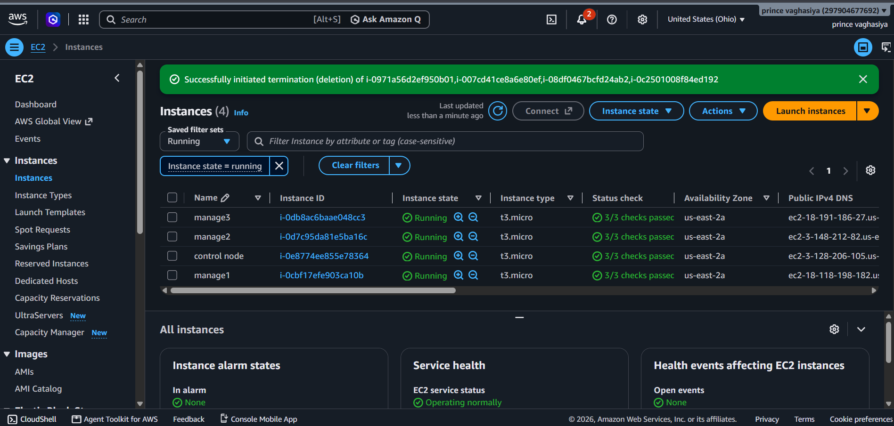
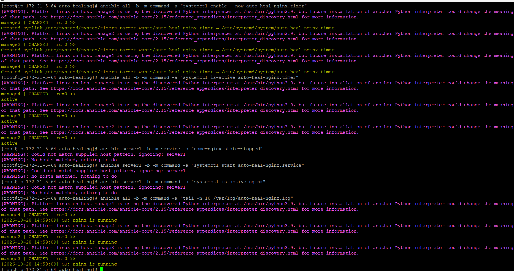
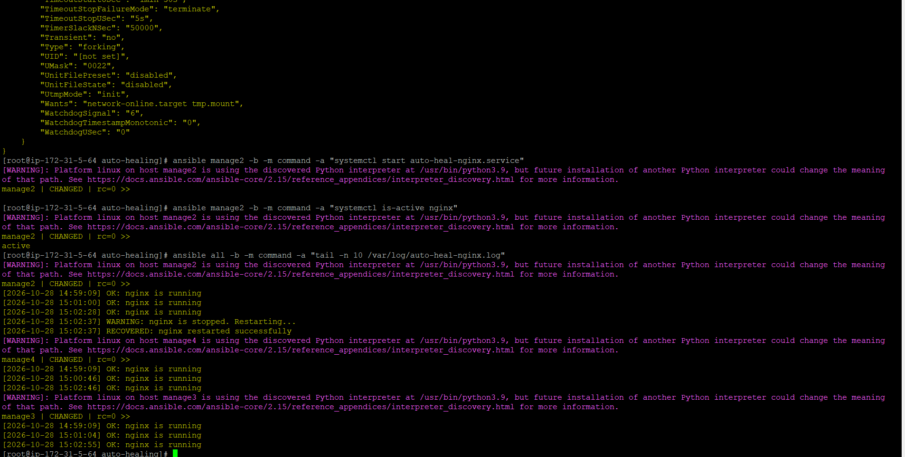
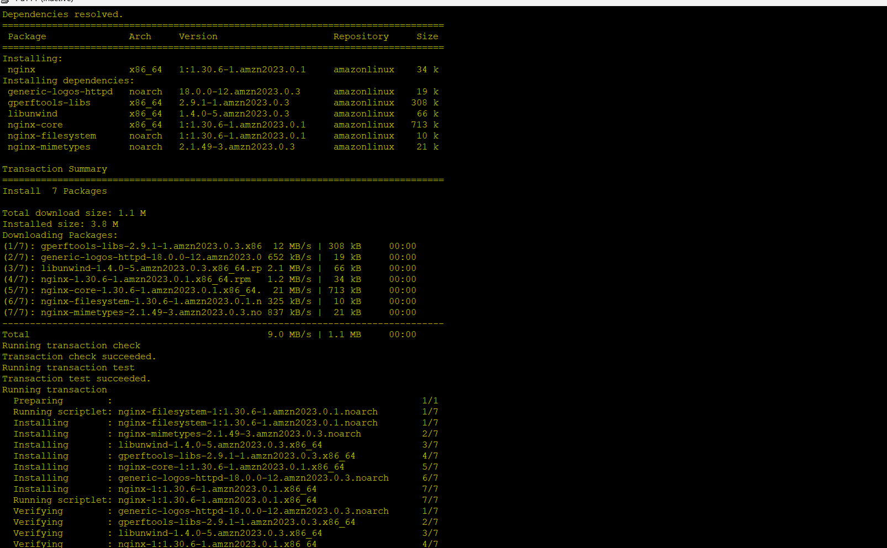
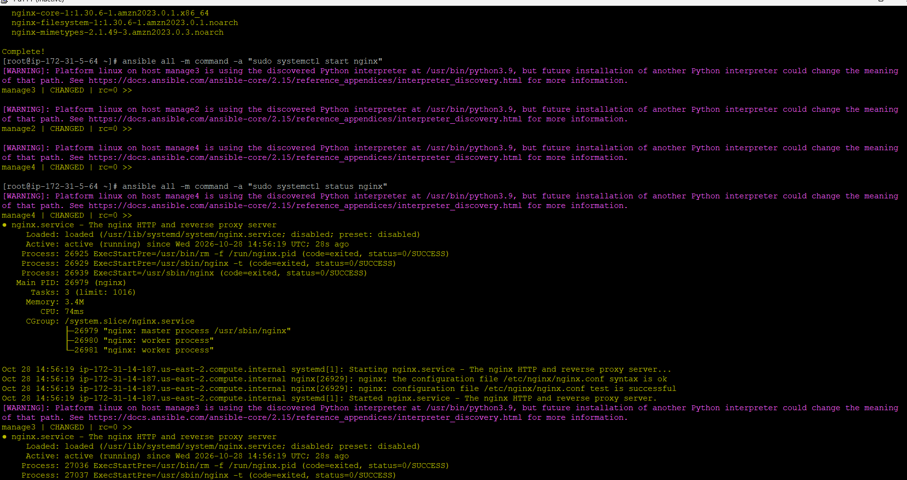
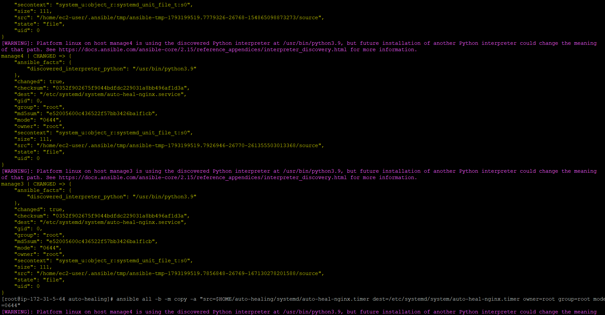

# Auto-Healing Linux Services on AWS EC2

A hands-on DevOps project that uses **AWS EC2, Linux, Bash, systemd, Nginx, and Ansible ad-hoc commands** to check Nginx health on multiple Linux servers and attempt automatic service recovery.

> **Project goal:** If Nginx stops on a managed server, a Bash health-check script detects the failure, attempts to restart Nginx, verifies the service state, and records the result in a log file.

## Project Highlights

- One Ansible control node manages multiple Linux EC2 instances.
- Nginx is installed on the managed nodes.
- A Bash script checks whether Nginx is active.
- A `systemd` service runs the health-check script.
- A `systemd` timer schedules periodic checks.
- Recovery attempts and service status are recorded in `/var/log/auto-heal-nginx.log`.
- Ansible ad-hoc commands are used to configure and check the nodes without playbooks.

## Architecture

```text
                    AWS Cloud
                       |
              +-------------------+
              | Ansible Control   |
              | Node (EC2)        |
              +-------------------+
                 |      |      |
                SSH    SSH    SSH
                 |      |      |
          +------+  +------+  +------+
          | Node 1|  | Node 2|  | Node 3|
          | Nginx |  | Nginx |  | Nginx |
          | Bash  |  | Bash  |  | Bash  |
          | Timer |  | Timer |  | Timer |
          +-------+  +-------+  +-------+

On each managed node:
systemd timer -> systemd service -> Bash health check
                                  |
                         Check Nginx status
                                  |
                 +----------------+----------------+
                 |                                 |
             Nginx active                    Nginx stopped
                 |                                 |
              Log OK                         Restart Nginx
                                                   |
                                           Verify and log result
```

## Technologies Used

| Technology | Purpose |
|---|---|
| AWS EC2 | Hosts the control node and managed Linux servers |
| Linux | Operating system and service management |
| Ansible | Runs remote commands across managed nodes |
| Bash | Implements the Nginx health-check and recovery logic |
| systemd service | Executes the health-check script |
| systemd timer | Schedules periodic health checks |
| Nginx | Example service being monitored |
| SSH | Secure communication between control and managed nodes |
| Git/GitHub | Version control and project documentation |

## Repository Structure

```text
auto-healing-linux-services/
├── README.md
├── .gitignore
├── scripts/
│   └── auto_heal_nginx.sh
├── systemd/
│   ├── auto-heal-nginx.service
│   └── auto-heal-nginx.timer
└── screenshots/
    ├── aws-ec2-instances.png
    ├── nginx-installation.png
    ├── nginx-service-status.png
    ├── auto-heal-timer-setup.png
    ├── auto-healing-recovery-logs.png
    └── ansible-copy-configuration.png
```

## Screenshots

### 1. AWS EC2 Infrastructure

The EC2 console shows the control node and managed Linux instances used for the lab.



### 2. Nginx Installation

Nginx and its required packages are installed on the Linux managed nodes.



### 3. Nginx Service Status

The service status output is used to confirm that Nginx is running.



### 4. Auto-Healing Timer Setup

The systemd timer is enabled on the managed nodes to schedule health checks.



### 5. Recovery Logs

The log records normal checks and recovery events. The example output includes a stopped Nginx service and a successful restart.



### 6. Deploying Configuration with Ansible

Ansible copies the systemd configuration to the managed nodes.



## How It Works

1. The systemd timer triggers the `auto-heal-nginx.service` on its schedule.
2. The service executes `/usr/local/bin/auto_heal_nginx.sh`.
3. The script checks whether Nginx is active.
4. If Nginx is active, the script writes an `OK` message to the log.
5. If Nginx is stopped, the script attempts to restart it.
6. The script checks the service state again and logs whether recovery succeeded.

## Example Commands

Run these commands from the **Ansible control node**. Replace host names with the names defined in your inventory.

### Check connectivity

```bash
ansible all -m ping
```

### Check Nginx on all managed nodes

```bash
ansible all -b -m command -a "systemctl is-active nginx"
```

### Check the timer on all managed nodes

```bash
ansible all -b -m command -a "systemctl is-active auto-heal-nginx.timer"
```

### View recovery logs

```bash
ansible all -b -m command -a "tail -n 20 /var/log/auto-heal-nginx.log"
```

### Test recovery on one host

Use a lab server only. Replace `manage2` with a host name from your inventory.

```bash
# Stop Nginx for testing
ansible manage2 -b -m service -a "name=nginx state=stopped"

# To test the recovery script manually
ansible manage2 -b -m command -a "systemctl start auto-heal-nginx.service"

# Verify the service state
ansible manage2 -b -m command -a "systemctl is-active nginx"

# Review the recovery log
ansible manage2 -b -m command -a "tail -n 10 /var/log/auto-heal-nginx.log"
```

**Note:** Manually starting `auto-heal-nginx.service` tests the recovery script. To prove scheduled automatic recovery, stop Nginx and wait for the timer's next run without manually starting the service, then verify the service status and journal/log output.

## Log Location

```text
/var/log/auto-heal-nginx.log
```

Typical messages include:

```text
OK: nginx is running
WARNING: nginx is stopped. Restarting...
RECOVERED: nginx restarted successfully
CRITICAL: nginx restart failed
```

## Security and Cost Notes

- Do not commit private SSH keys (`.pem`), passwords, AWS access keys, or tokens.
- Keep EC2 security groups restricted to the required sources and ports.
- This is a learning/lab project. Test changes on non-production instances first.
- Stop or terminate EC2 instances when the lab is not in use to avoid unnecessary charges.

## What I Learned

- Managing multiple EC2 Linux servers from a central Ansible control node.
- Using Ansible ad-hoc commands for remote administration.
- Writing Bash scripts for service health checks and recovery.
- Configuring systemd services and timers.
- Reading logs to troubleshoot service issues.
- Documenting a hands-on DevOps project for a GitHub portfolio.

## Future Improvements

- Send an alert when recovery fails.
- Generate a consolidated health report for all managed nodes.
- Add retry limits and more detailed error handling.
- Add a dashboard for server and service status.
- Add a CI workflow to lint and test the Bash script.

---

**Project:** Auto-Healing Linux Services  
**Focus:** Linux Administration | AWS | Ansible | Bash Automation | Service Reliability

Author 
**Prince Vaghasiya**
